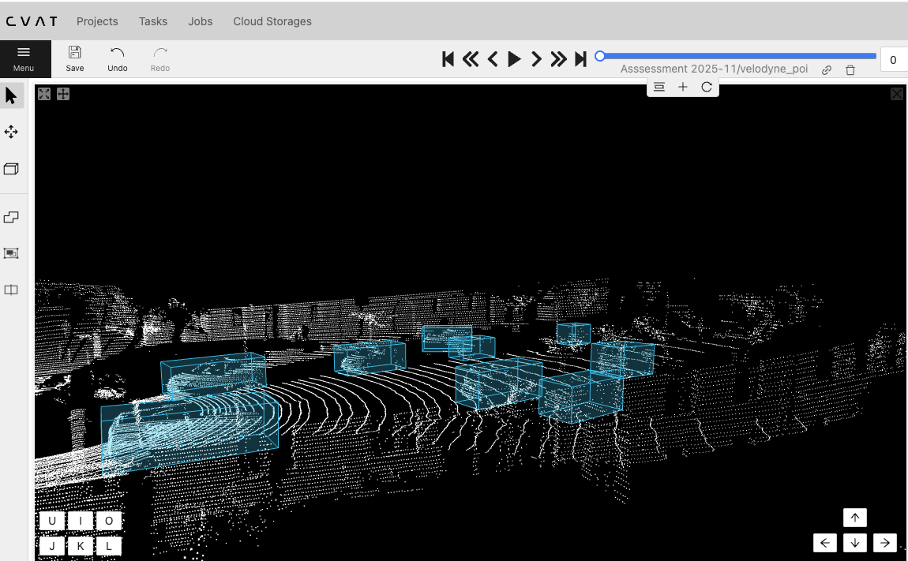
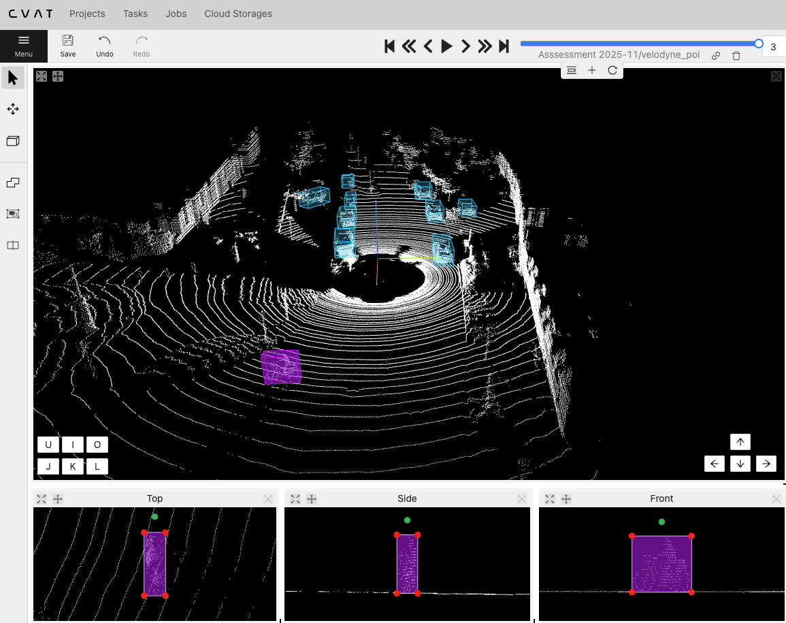
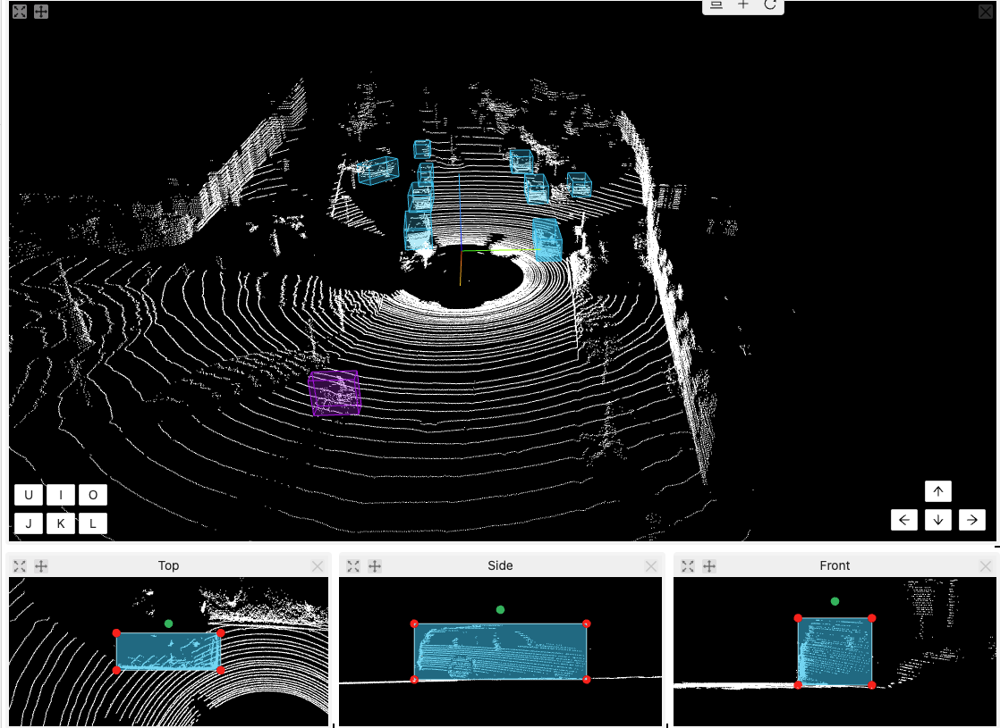
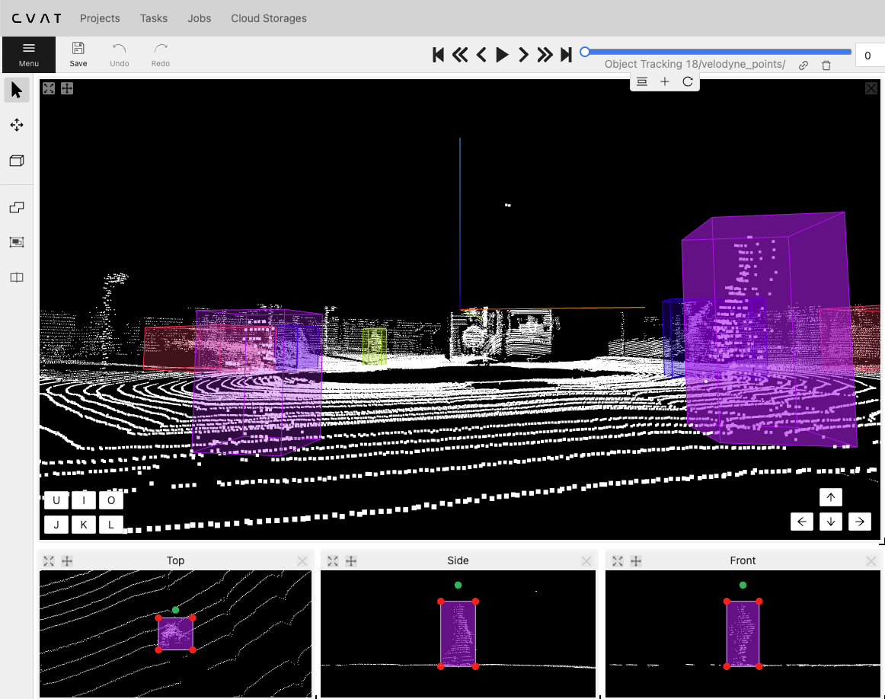
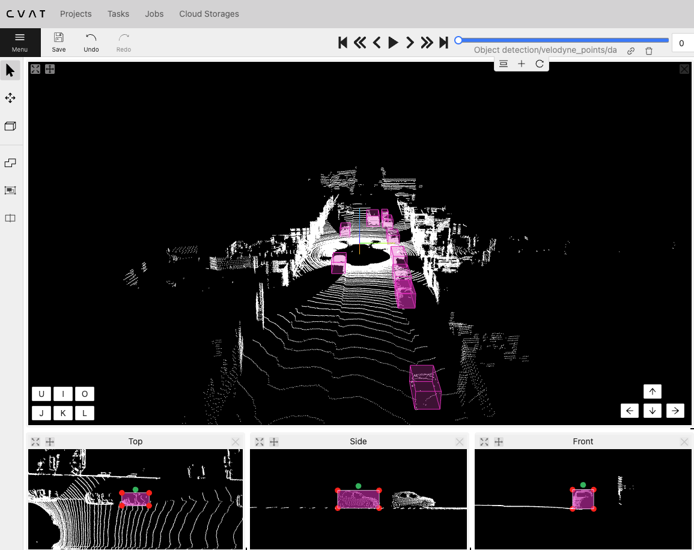

# 3D LiDAR Point Cloud Annotation

## Project Overview

This project documents my hands-on 3D LiDAR point cloud annotation practice completed during DeeLab Academy's **3D Point Cloud Essentials** training using CVAT.

The project focuses on 3D object detection, cuboid annotation, alignment, and object tracking.

## Tools

- CVAT
- 3D LiDAR point clouds
- 3D cuboid annotation tools

## Annotation Techniques

- **3D Object Detection:** Identified objects within LiDAR point cloud scenes.
- **3D Cuboid Annotation:** Created 3D bounding boxes around objects.
- **Cuboid Alignment:** Adjusted cuboid position, dimensions, and orientation.
- **Multi-View Annotation:** Used Top, Side, and Front views to refine cuboid placement.
- **3D Object Tracking:** Practiced tracking objects and refining annotations across frames.

## Annotation Examples

### 1. Multi-Object Cuboid Annotation

### 2. Cuboid Alignment Using Multiple Views

### 3. Cuboid Position and Size Adjustment

### 4. 3D Object Tracking

### 5. 3D Object Detection

## Training

**3D Point Cloud Essentials — DeeLab Academy (2026)**

## Skills Demonstrated

3D LiDAR Annotation · Point Cloud Labeling · 3D Object Detection · Cuboid Alignment · Multi-Object Annotation · 3D Object Tracking · CVAT
